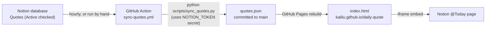

# Daily Quote

A tiny quote widget, embedded in my Notion daily backlog. It shows one quote per day
and a "New" button for a random one.

- Live page: https://kalilu.github.io/daily-quote
- Source of truth: the **Quotes** database in Notion (Daily Quotes hub page)
- `quotes.json` is a **generated copy** of Notion. Never edit it by hand.

## How it works



Why the extra hop: the page is static and runs in the browser, so it cannot call the
Notion API directly (the token would be public, and Notion blocks browser calls with
CORS). The Action holds the secret, reads Notion, and writes a plain JSON file the
page can fetch.

What the page does:

1. Loads `quotes.json` (falls back to 5 built-in quotes if it cannot).
2. **Daily quote:** hashes today's date to pick an index, so the same quote shows all day.
3. **New button:** picks a random quote different from the current one.
4. **Copy button:** copies the quote and author to the clipboard.

## Day to day: how to use it

All editing happens in Notion. No code, no pushes.

| I want to... | Do this in Notion |
|---|---|
| Add a quote | New row: fill **Quote**, **Author** (full name), pick **Tags**, tick **Active** |
| Stage a quote for later | Add the row but leave **Active** unticked |
| Retire a quote | Untick **Active** (do not delete, so it can come back) |
| Fix a typo | Edit the row |

Changes appear on the widget after the next sync (hourly), or right away if you run
the sync by hand (below). Only rows with **Active** ticked are published.

Notes:
- Tags must already exist as options in the database before you use them.
- Duplicate quote text is dropped (case-insensitive).
- The daily quote shifts when the number of active quotes changes, because the
  pick is `hash(date) % number_of_quotes`. That is expected.

## Run the sync now

GitHub: repo, **Actions** tab, **Sync quotes from Notion**, **Run workflow**.

Or with the CLI:

```bash
gh workflow run "Sync quotes from Notion" --repo kalilu/daily-quote
gh run watch --repo kalilu/daily-quote
git pull   # fetch the bot's commit of quotes.json
```

## One-time setup

1. Create a Notion internal integration (notion.so/profile/integrations) and copy its secret.
2. Open the Daily Quotes hub page in Notion, `...` menu, **Connections**, add the integration.
   Without this the Action gets a 404 from Notion.
3. Add the secret to the repo: Settings, Secrets and variables, Actions,
   new secret named `NOTION_TOKEN`.
4. Make sure the workflow file is on the default branch (`main`). Scheduled workflows
   only run from there.
5. Run the workflow once by hand and check it goes green.

## Troubleshooting: "I changed Notion but the widget did not update"

Go through these in order:

1. **Is Active ticked?** Staged quotes (Active unticked) are never published.
2. **Did the Action run?** Repo, Actions tab. Look at the latest "Sync quotes from Notion" run.
   - Red with `404` or `object_not_found`: the integration is not connected to the page (step 2 above).
   - Red with `401`: the `NOTION_TOKEN` secret is missing or wrong.
   - No runs at all: the workflow is not on `main`, or Actions are disabled. Run it by hand.
   - "No changes": Notion matched what `quotes.json` already has.
3. **Did it commit?** `git pull` and check `git log -- quotes.json` for a
   "chore: sync quotes from Notion" commit.
4. **Pages caching:** after the commit, give Pages a minute or two. Then hard refresh
   (Ctrl+Shift+R). In Notion, the embed may keep an old copy: bump the version in the
   embed URL (`?v=2` to `?v=3`).
5. **Still stuck?** Open https://kalilu.github.io/daily-quote/quotes.json and check that
   your quote is in the file. If it is, the problem is only browser or Notion caching.

## Repo layout

```
index.html                         the widget (HTML, CSS, JS in one file)
quotes.json                        generated from Notion, do not edit
scripts/sync_quotes.py             Notion to quotes.json (standard library only)
.github/workflows/sync-quotes.yml  hourly schedule + manual trigger
```

## Good to know

- `quotes.json` has no timestamp on purpose, so identical content gives identical
  bytes and the workflow only commits when something really changed.
- If Notion returns zero active quotes, the sync fails and keeps the old file
  (protects against a wrong ID, revoked access, or every row unticked).
- GitHub pauses scheduled workflows after about 60 days without repo activity.
  If quotes stop updating months from now, re-enable it in the Actions tab.
